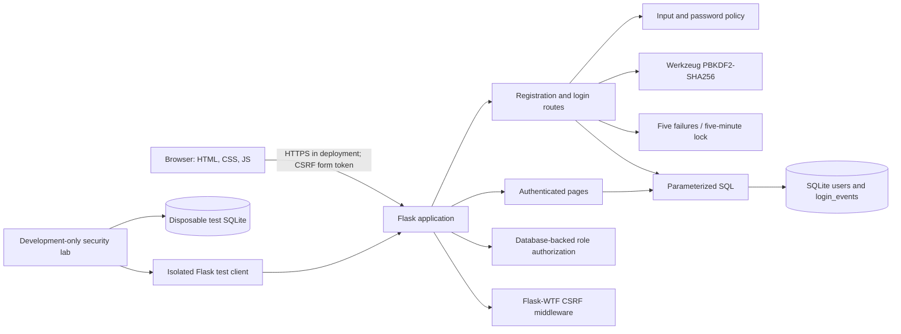

# SecureAuth architecture

## Components

- `secureauth/__init__.py` constructs the Flask application, configures cookies and idle expiry, registers blueprints, and exposes the administrator promotion CLI command.
- `secureauth/auth.py` validates registrations, verifies password hashes, tracks lockout state and login events, and creates/clears session state.
- `secureauth/db.py` owns the schema and request-scoped SQLite connection.
- `secureauth/pages.py` implements authenticated views and role checks. Roles are loaded from SQLite, not accepted from request data or the session.
- `secureauth/testing_center.py` creates a separate app and temporary database per run; it uses only a synthetic test account.
- Templates use a shared responsive layout. JavaScript reveals passwords and estimates composition strength in the browser; authoritative validation remains server-side.

## Database

`users` stores a password hash, constrained role, failed-attempt count, lock expiry, creation time, and last successful login. Case-insensitive unique indexes prevent duplicate usernames and emails. `login_events` stores a user reference where known, the attempted identity, success flag, and UTC timestamp. It has no password field.
